# QuestMVVM_0145

An Android application built with Jetpack Compose implementing MVVM architecture, StateFlow, and Navigation Compose for student registration and details display.

## Project Structure & Implementation Screenshots

### 1. Struktur Folder (Project Structure)
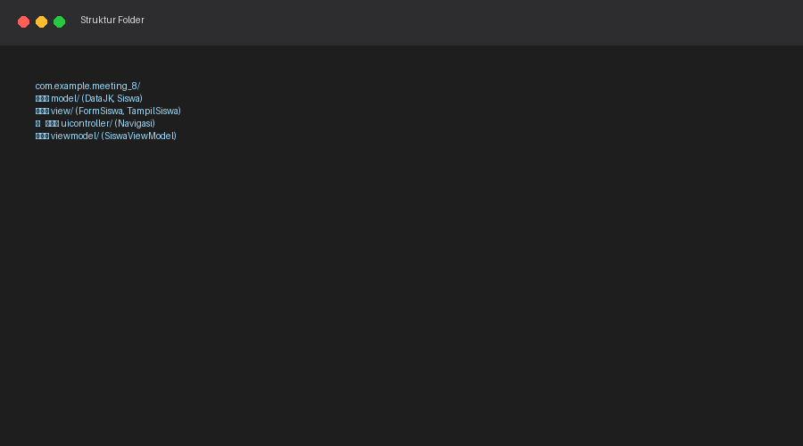

### 2. Model Siswa (`Siswa.kt`)
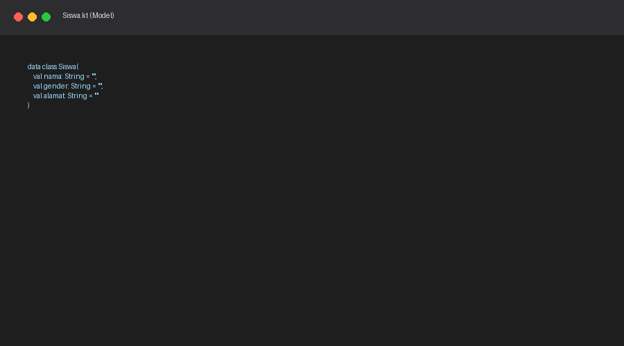

### 3. DataJK (`DataJK.kt`)
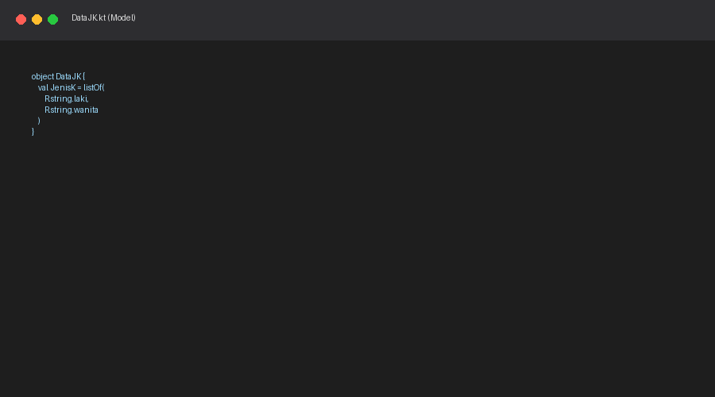

### 4. String Resources (`strings.xml`)
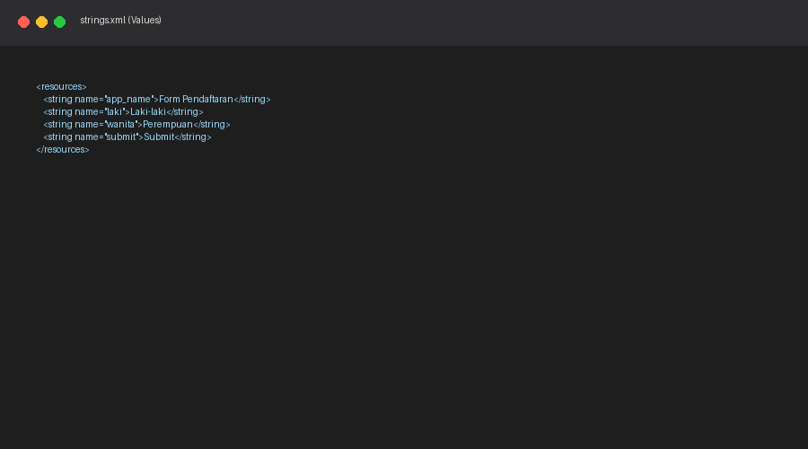

### 5. Dimension Resources (`dimens.xml`)
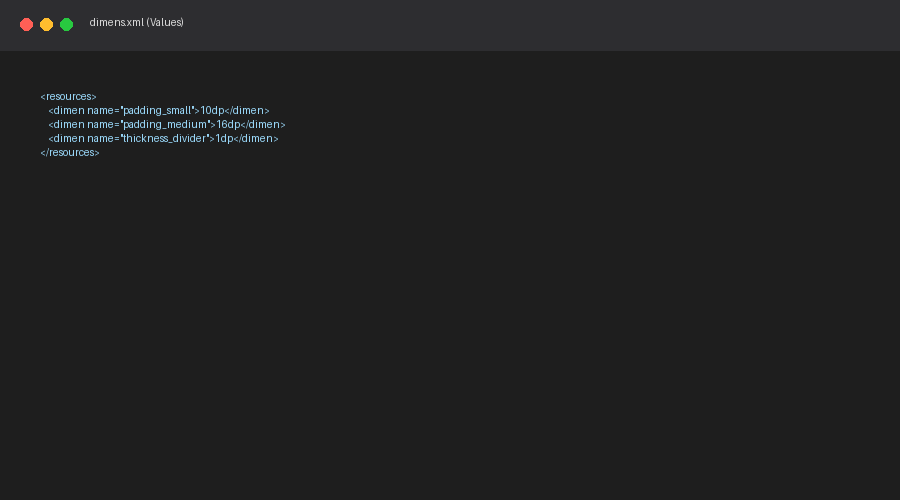

### 6. Dependencies & Gradle (`gradle`)
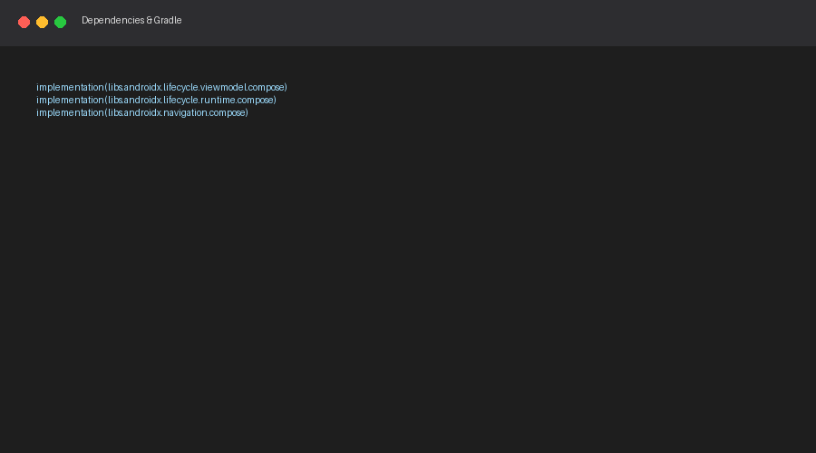

### 7. SiswaViewModel (`SiswaViewModel.kt`)
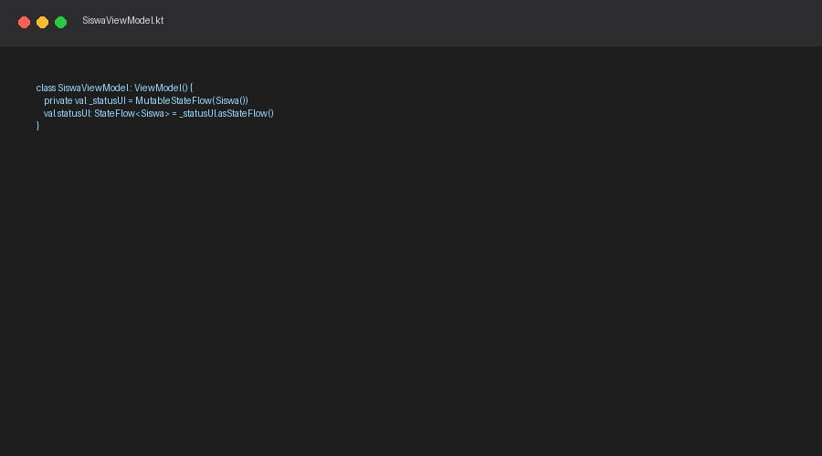

### 8. FormSiswa (`FormSiswa.kt`)
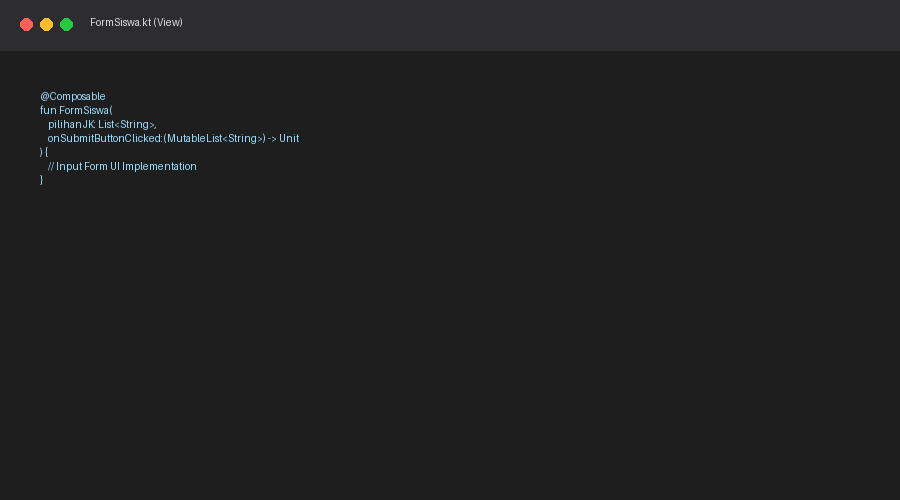

### 9. TampilSiswa (`TampilSiswa.kt`)
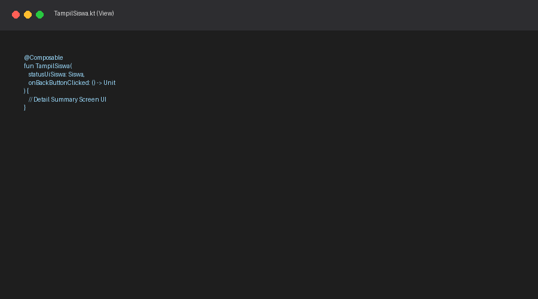

### 10. Navigasi (`Navigasi.kt`)
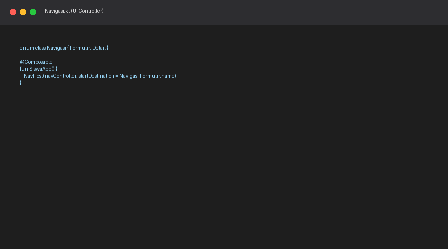

### 11. MainActivity (`MainActivity.kt`)
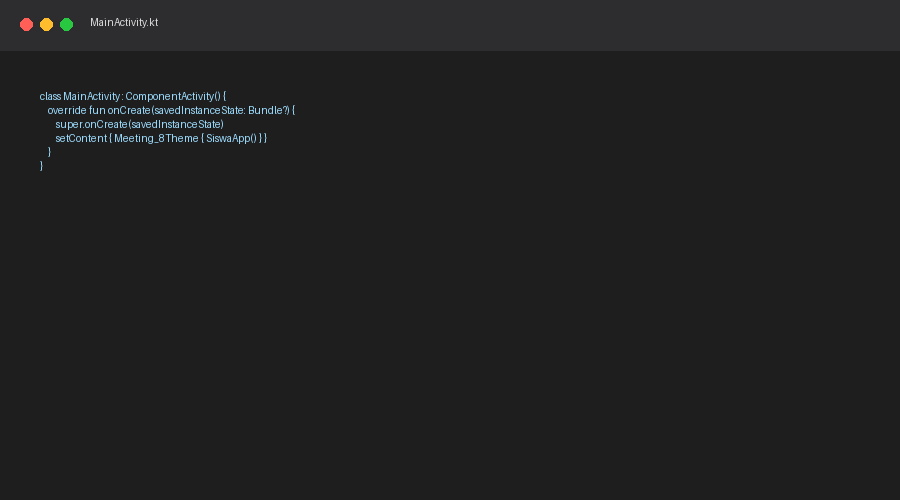
